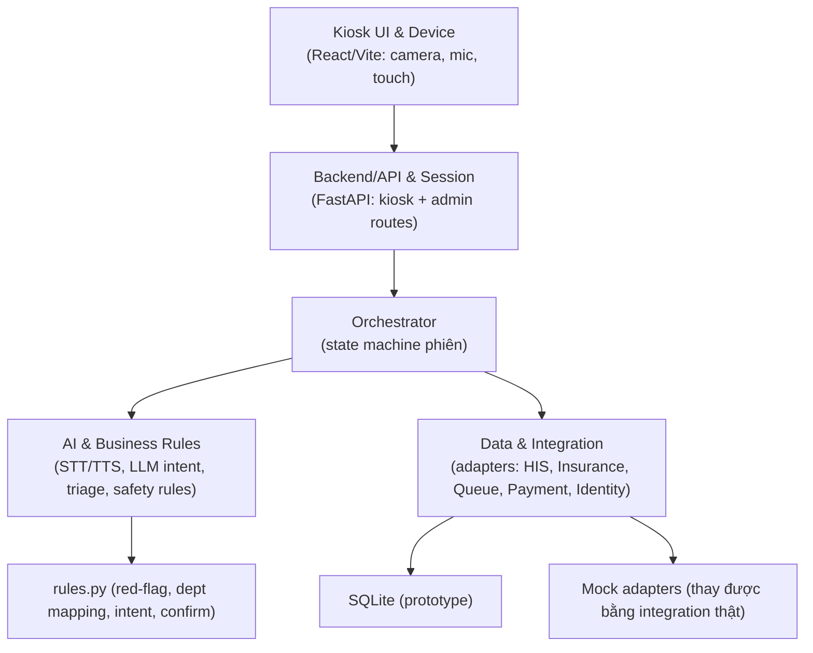

# ARCHITECTURE — MedFlow AI

## 4 lớp logic (PRD mục 11)

## Thành phần
| Lớp | Thư mục | Vai trò |
|---|---|---|
| UI & Device | `frontend/src/` | 15 màn hình, camera, voice, touch fallback |
| Backend/API | `backend/app/api/` | `kiosk.py` (13 endpoint), `admin.py` (dashboard) |
| Session | `backend/app/orchestrator.py`, `session.py` | State machine, điều phối luồng |
| AI & Rules | `backend/app/services/`, `rules.py` | LLM intent, triage, STT/TTS/OCR/face |
| Data & Integration | `backend/app/db/`, `adapters/` | Models + mock adapters |

## Nguyên tắc
- **Adapter pattern**: business logic chỉ gọi interface (`app/adapters/base.py`), mock được thay bằng integration thật.
- **Rule-first cho an toàn**: red-flag và đề xuất khoa luôn đi qua `rules.py` (testable).
- **Lazy-load model nặng**: face/stt/tts/ocr import lazy, backend khởi động không cần ONNX/CV2.
- **Frontend state mirror backend state**: `useKiosk` map `session.state` → màn hình.

## Điểm quyết định (xem ADR)
- ADR-0001: Monorepo `backend/` + `frontend/` + `docs/` + `tests/`.
- ADR-0002: SQLite prototype + adapter mock.
- ADR-0003: Rule engine tiếng Việt không dấu.
