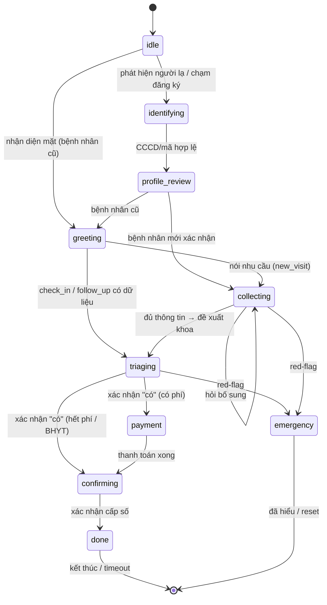

# USER FLOWS — State Machine (MedFlow AI)

## State machine phiên (backend `session.py`)

## Luồng bệnh nhân cũ
Phát hiện → nhận diện mặt → chào + hồ sơ → (check-in | tái khám | triệu chứng mới) → đề xuất → queue → xác nhận → cấp số.

## Luồng bệnh nhân mới
Phát hiện → CCCD → hồ sơ (BHYT) → AI hỏi triệu chứng → đề xuất → queue → thanh toán (nếu có) → xác nhận → cấp số.

## Luồng cảnh báo (red-flag)
Phát hiện dấu hiệu → dừng luồng → hiển thị cảnh báo → hướng dẫn gặp nhân viên y tế → ghi nhận sự kiện.
